[README.md](https://github.com/user-attachments/files/33895669/README.md)
# AeroShield SOC Lab: Active Directory Build, Hardening and Detection

**At a glance**
- **Built:** Windows Server 2022 domain controller (AD, DNS, Group Policy) and a domain-joined Windows 10 workstation
- **Hardened:** password and lockout policy, least privilege, named admin accounts, Advanced Audit Policy by GPO
- **Detected:** ran a password-guessing test and confirmed Wazuh received the failed logons (4625) and lockout (4740)
- **Tools:** Active Directory · Group Policy · PowerShell · Wazuh SIEM · Windows event logs

A four-day team build of a security operations lab for a fictional aerospace and satellite company, completed in the Rapid Ascent Cybersecurity Program (City University of Seattle). I was the Security Engineer and built the Windows side: the domain controller, the engineering workstation, and the policies that harden and monitor them. I finished by running a password-guessing test and confirming the SIEM caught it.

> **Scope:** seven-person team, four days in a training cyber range. A full deployment was not the goal. This page separates what I **built and verified** from what I **designed but did not implement**. All company details are fictional, and no credentials appear in this repository.

---

## Highlight: password-guessing test, caught end to end

I signed in to the workstation as a standard user with the wrong password until the account locked, then checked what the SOC would see.

**1. The policy stopped it.** After 5 bad attempts, Windows locked the account.

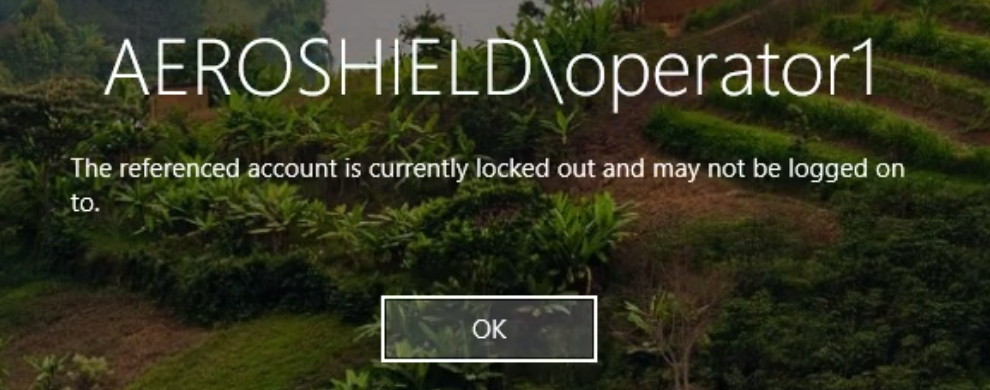

**2. The SIEM saw it.** Wazuh received event **4625** (failed logon) from the workstation for each attempt and event **4740** (account locked out) from the domain controller, all for the same user and about 2 milliseconds apart.

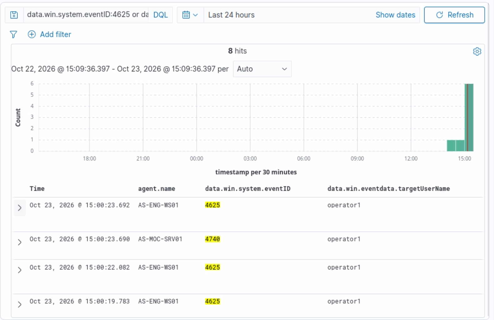

**3. Recovery.** I unlocked the account from the domain controller and confirmed it was no longer locked.

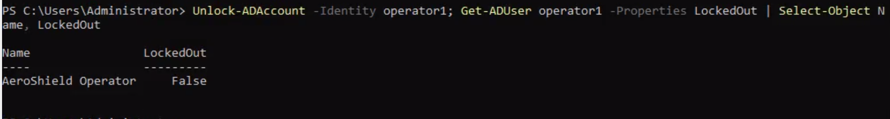

**Why it matters:** in a real attack, a burst of 4625s followed by 4740s across many accounts is what password spraying looks like. This test proves the full chain works: policy, logging, collection and search.

---

## My role

**Security Engineer:** network security design, Active Directory, hardening and logging.

- Built the Windows Server 2022 domain controller, DNS and OU structure
- Joined and configured the Windows 10 engineering workstation
- Applied password, lockout, screen-lock and audit policy through Group Policy
- Wrote the security control plan and validation checklist

---

## Architecture

| System | OS | Role | Built by |
|---|---|---|---|
| AS-MOC-SRV01 | Windows Server 2022 (evaluation) | Domain controller, DNS, Group Policy | Me |
| AS-ENG-WS01 | Windows 10 Pro | Engineering workstation (legacy OS) | Me |
| AS-SOC-WS01 | Ubuntu Desktop | Wazuh SIEM manager | Teammate |
| AS-GS-CON01 | Ubuntu Server 24.04 | Yamcs mission control (satellite command and telemetry) | Teammate |

### As built (what actually ran)

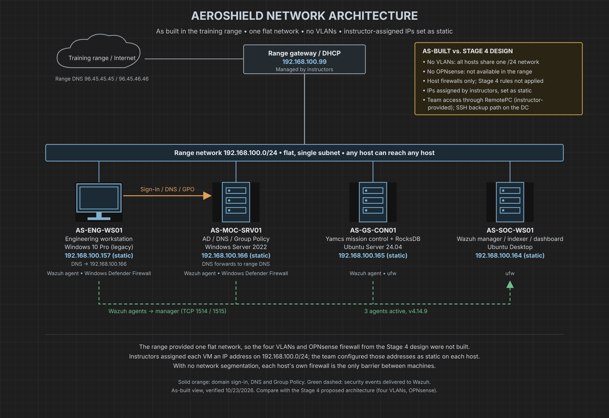

The training range gave us **one flat network (192.168.100.0/24) with no VLANs**. Instructors assigned each VM an IP address, and we configured those addresses as **static** on each host so the DC, DNS records and Wazuh agents always point at the right machine. With no segmentation, each host's own firewall is the only barrier between machines.

### Designed (Stage 4 plan, not implemented)

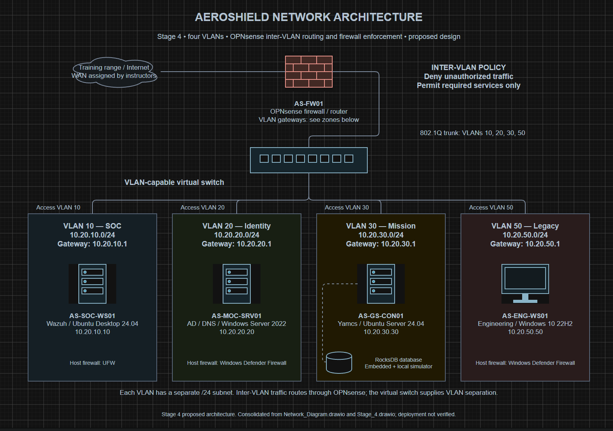

The plan put each system in its own VLAN (SOC, Identity, Mission, Legacy), with an OPNsense firewall routing between them and blocking anything not explicitly allowed. The range couldn't provide VLANs or OPNsense, so this remains the target architecture.

### Logical view (what talks to what)

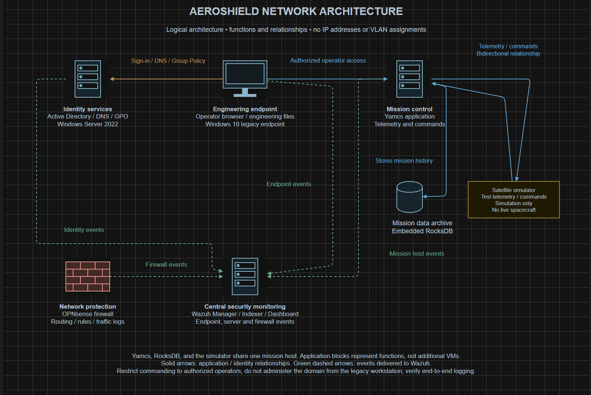

---

## Built and verified: domain controller (AS-MOC-SRV01)

**Static IP, with the DC using itself for DNS.** A domain controller needs an address that never changes, because every machine in the domain looks it up.

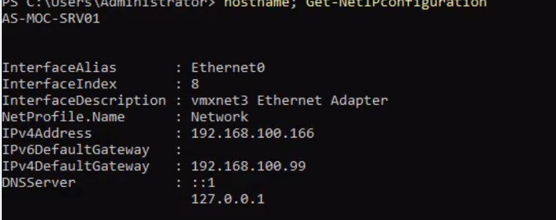

**SSH as a backup admin path,** in case the remote-access tool failed. Installed, running, set to start automatically and allowed through the firewall.

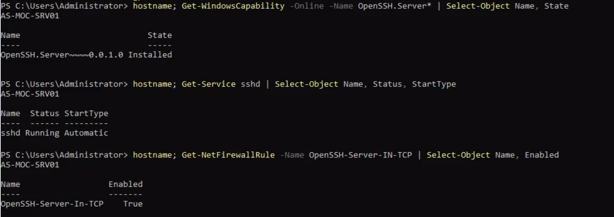

**The aeroshield.internal domain,** with this server as the primary domain controller (PDC emulator). I renamed the server before promoting it, so the correct name was recorded in AD and DNS from the start.

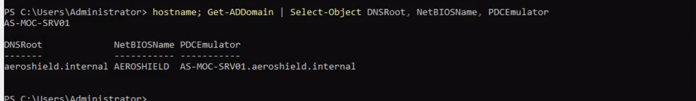

**DNS.** Records for the Linux servers so machines can reach them by name, plus forwarding so internet names still resolve.

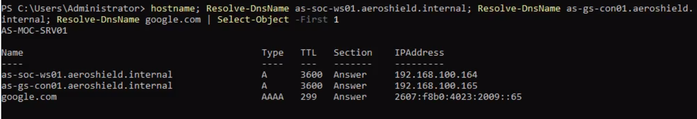

**OU structure.** `AeroShield > Workstations, Staff` lets Group Policy target computers and users separately. The workstation sits in the Workstations OU.

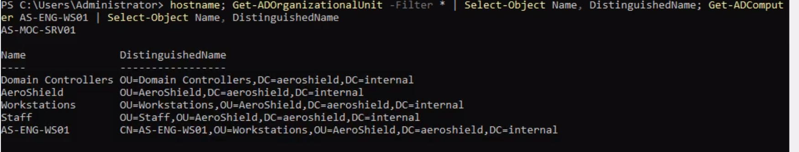

**Separate accounts for separate jobs.** operator1 is a standard user for daily work; sylas.adm is a named admin account, so logs show *who* made a change instead of just "Administrator."

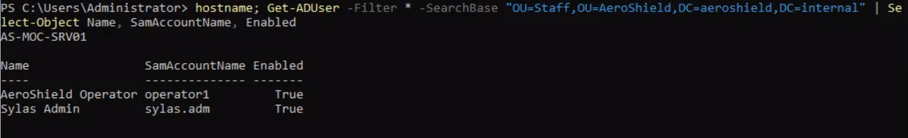
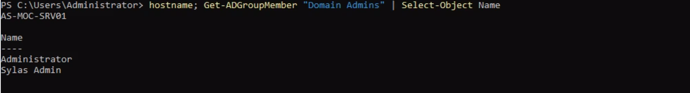

**Password and lockout policy (domain-wide).** 14-character minimum, complexity, 24 remembered passwords, and a 15-minute lockout after 5 failed attempts.

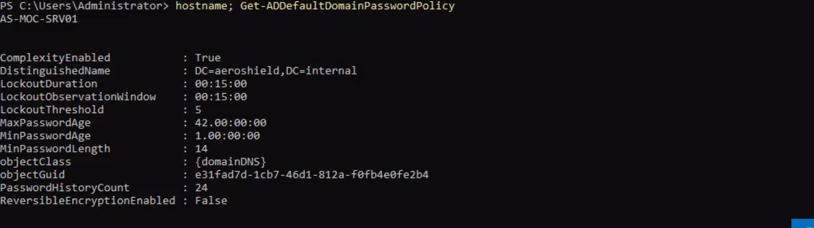

**Group Policy objects linked to their OUs.** `AS-WS-Baseline` targets workstations; `AS-DC-Audit` targets domain controllers.

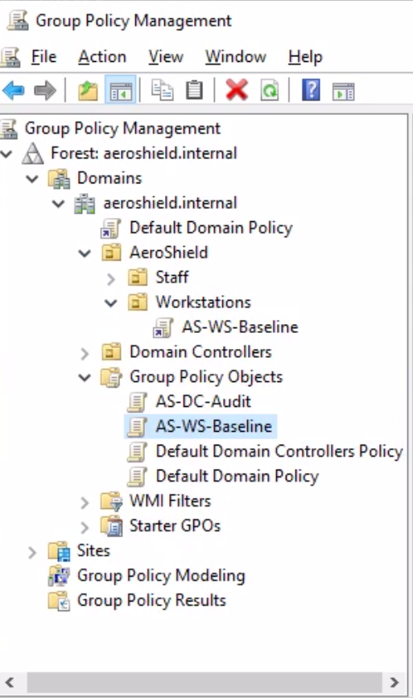

**Audit logging on the DC.** Advanced Audit Policy records logons, lockouts, Kerberos activity, account and group changes, directory changes and changes to the audit policy itself (so an attacker turning logging off gets logged too).

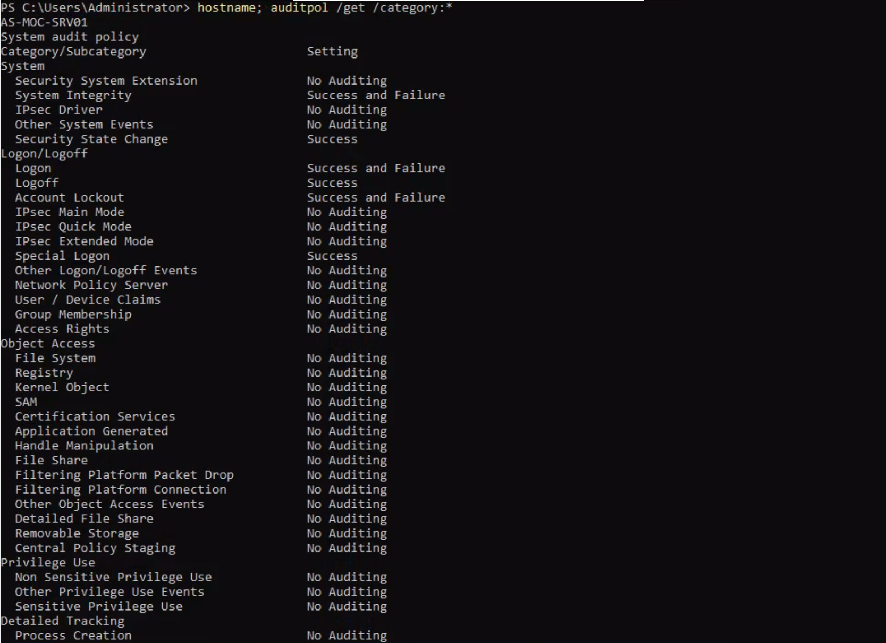
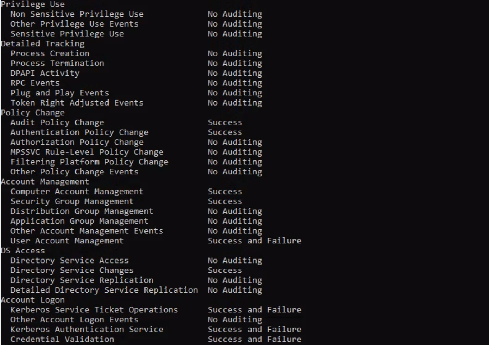

**Proof the logging works.** Event 4728 recorded my admin account being added to Domain Admins, including *who* did it. Unexpected additions to admin groups are a common attacker step.

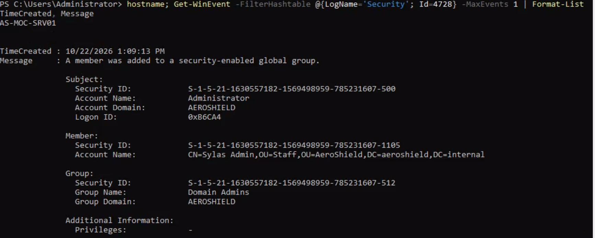

**The audit GPO is actually applied** to the DC, alongside the default domain policies.

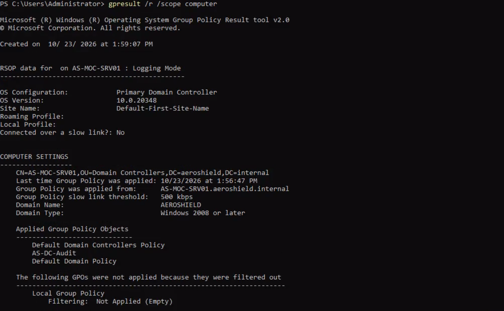

---

## Built and verified: workstation (AS-ENG-WS01)

**Joined to the domain, with DNS pointing only at the DC.** Using outside DNS here was the first thing that broke during the build (see Troubleshooting).

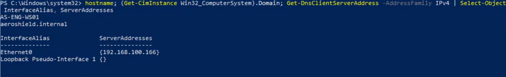

**Least privilege.** The daily user (operator1) is not in the local Administrators group. The workstation is the machine most likely to be phished, so it never holds admin rights for daily work.

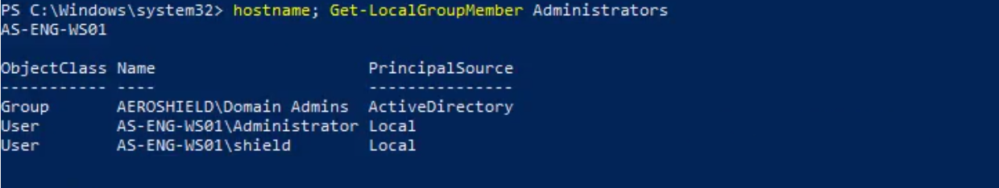

**Workstation baseline GPO applied.**

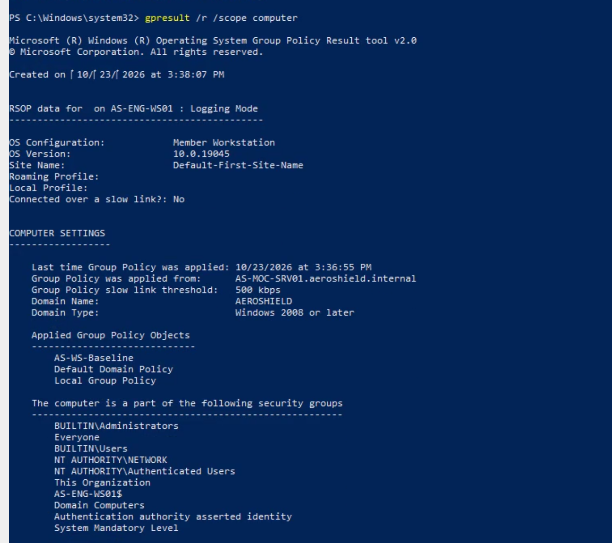

**Screen lock set by the GPO.** It's set to **1800 seconds (30 minutes)**, a documented exception to the CIS Level 1 recommendation of 900 seconds or less. Teammates were sharing remote sessions during the build and kept getting locked out. In production it would be 900.

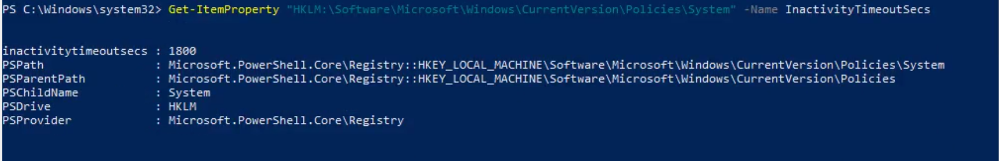

---

## Built and verified: SIEM visibility

**All three endpoints reporting to Wazuh.** (The Wazuh server itself was built by a teammate; I verified the Windows agents and used it for the lockout test above.)

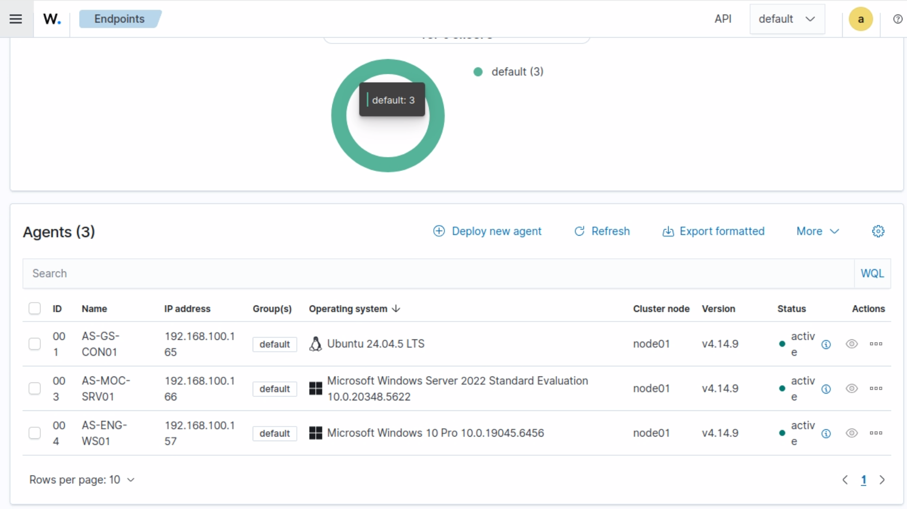

<details>
<summary>Key commands</summary>

```powershell
# Create the domain
Install-WindowsFeature AD-Domain-Services -IncludeManagementTools
Install-ADDSForest -DomainName "aeroshield.internal" -DomainNetbiosName "AEROSHIELD" -InstallDns

# OU structure
New-ADOrganizationalUnit -Name "AeroShield" -Path "DC=aeroshield,DC=internal"
New-ADOrganizationalUnit -Name "Workstations" -Path "OU=AeroShield,DC=aeroshield,DC=internal"
New-ADOrganizationalUnit -Name "Staff" -Path "OU=AeroShield,DC=aeroshield,DC=internal"

# Join the workstation and place it in the right OU
Add-Computer -DomainName "aeroshield.internal" -Credential "AEROSHIELD\Administrator" -Restart
Get-ADComputer AS-ENG-WS01 | Move-ADObject -TargetPath "OU=Workstations,OU=AeroShield,DC=aeroshield,DC=internal"

# Password and lockout policy
Set-ADDefaultDomainPasswordPolicy -Identity aeroshield.internal -MinPasswordLength 14 -ComplexityEnabled $true `
  -LockoutThreshold 5 -LockoutDuration 00:15:00 -LockoutObservationWindow 00:15:00

# GPOs linked to their OUs
New-GPO -Name "AS-DC-Audit"    | New-GPLink -Target "OU=Domain Controllers,DC=aeroshield,DC=internal"
New-GPO -Name "AS-WS-Baseline" | New-GPLink -Target "OU=Workstations,OU=AeroShield,DC=aeroshield,DC=internal"

# Verify
gpupdate /force
gpresult /r /scope computer
auditpol /get /category:*
Get-WinEvent -FilterHashtable @{LogName='Security'; Id=4728} -MaxEvents 1 | Format-List TimeCreated, Message

# Recover a locked account
Unlock-ADAccount -Identity operator1
```

Wazuh search used for the test: `data.win.system.eventID:4625 or data.win.system.eventID:4740`
</details>

---

## Troubleshooting log

| Problem | Cause | Fix |
|---|---|---|
| OpenSSH "installed" but the service didn't exist | Capability name typed with `----` instead of `~~~~`; no error, nothing installed | Re-ran with the correct name and checked the install state |
| Domain name wouldn't resolve on the workstation | Workstation still used the range's public DNS, which doesn't know the internal domain | Pointed DNS only at the DC; outside lookups go through its forwarders |
| Wazuh hostname resolved to two IPs | A second DNS record pointed at the Yamcs server | Removed the bad record by its IP and re-verified (below) |
| Audit categories that had been on showed "No Auditing" | Once a GPO defines *any* Advanced Audit setting, Windows drops all the defaults | Added every needed category to the GPO and compared before and after (below) |

**Duplicate DNS record before the fix:** about half the connections meant for Wazuh would have gone to the Yamcs server.

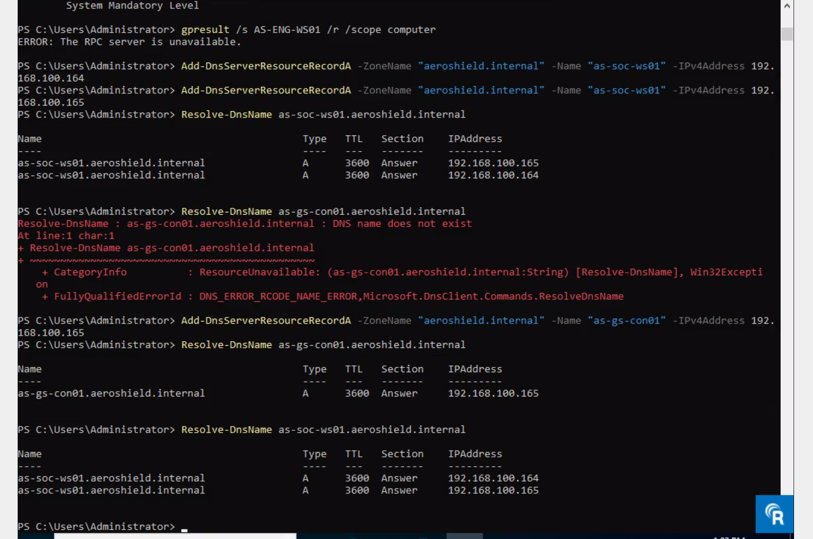

**Audit defaults dropped by the first version of the GPO** (compare with the audit policy screenshots above):

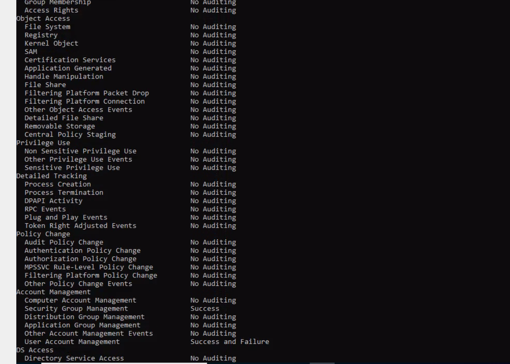

**Lesson:** "completed successfully" isn't proof. In three of these four problems, every command reported success. Only checking the result caught the mistake.

---

## Security controls

Mapped to the team risk register (CYB IDs).

| Risk | Control | Status |
|---|---|---|
| Compromised credentials (CYB-01) | 14-character password policy; lockout after 5 attempts; screen lock | Verified, lockout tested end to end |
| Excessive admin access (CYB-15) | Named admin accounts; daily user has no local admin rights | Verified |
| AD compromise, undetected changes (CYB-13, CYB-14) | Advanced Audit Policy on the DC; events forwarded to Wazuh | Verified |
| Exposed services (CYB-03) | Host firewalls default-deny inbound; SSH limited to an admin address | Designed |
| Unpatched legacy OS (CYB-07) | Windows Update policy by GPO; migration plan | Planned |
| Loss of the DC (CYB-05) | System state backups | Planned |

## Detections

| Event ID | What it means | Status in this lab |
|---|---|---|
| 4625 | Failed logon | Collected in Wazuh; tested |
| 4740 | Account locked out | Collected in Wazuh; tested |
| 4728 / 4732 / 4756 | Member added to a security group | Logged on the DC |
| 5136 | Directory object modified | Auditing enabled on the DC |

---

## Designed, not implemented

| Item | Status |
|---|---|
| Network segmentation: four VLANs enforced by an OPNsense firewall | Designed. OPNsense and VLANs weren't available in the range. |
| Host firewall rules (Windows Defender Firewall, ufw) from the same rule set | Designed, not applied |
| SSH on the DC restricted to an approved admin address | Not applied (SSH currently open to the range network) |
| Custom Wazuh alert rules (lockout bursts, admin-group changes) | Events collected and searchable; custom rules not built |
| Windows Update policy, DC backup, renaming the built-in Administrator | Planned in the control plan |

## If this were a production environment

Changes I'd make based on what I saw in this build:

- **Built-in Administrator:** it can't be deleted, so rename it, disable it, and alert on any use of it. Admins use named accounts instead. *(Lab note: screenshots were taken as the built-in Administrator; named admin accounts were created but not yet enforced.)*
- **LAPS** (Local Administrator Password Solution): the range used the same local admin account name (shield) on every machine; LAPS gives each machine's local admin a unique, rotating password
- **A second domain controller,** so one failure doesn't stop everyone from signing in
- **Screen lock at 900 seconds** to meet CIS Level 1

## Next steps with more time

- Apply the host firewall rules and verify what they block
- Restrict SSH on the DC to an admin IP
- Finish the workstation baseline: audit policy, USB storage blocking, Windows Update settings
- Install Sysmon on the Windows machines for richer process and network logs in Wazuh
- Build custom Wazuh alerts for lockout bursts and admin-group changes
- DHCP reservations so the IP addresses never change

---

## Design decisions

**Choosing mission-control software that matched the mission.** The first plan used Open MCT, which only displays telemetry. Our threat analysis named satellite command and control as the company's most critical capability, so we switched to Yamcs, which can also send commands.

**Keeping critical services on separate machines.** An early draft put the mission-control app on the domain controller. I flagged that one compromise would hand an attacker both, and the design was changed so the SIEM, DC and mission-control server each run on their own system.

**Adapting to the range.** The firewall I designed around wasn't available, so the same rule set was reassigned to each machine's own firewall.

---

## Skills demonstrated

Active Directory · DNS · Group Policy · Windows Server administration · PowerShell · Windows audit policy and event logs · Wazuh SIEM searching · account lockout testing · network segmentation and firewall design · risk assessment · security control planning · technical documentation

---

*Author: Sylas Perea · [LinkedIn](https://linkedin.com/in/sylas-perea)*
